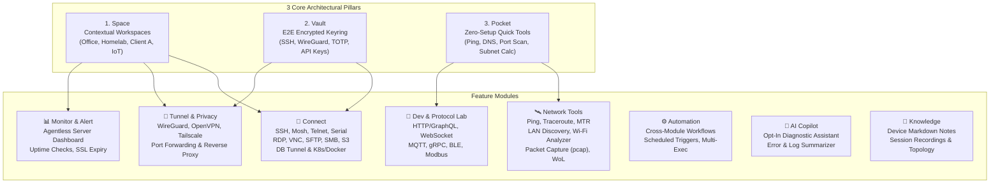

# Master Roadmap - ArnTCLI
Last Updated: 2026-10-19
Tagline: *"Your network, in your pocket."*
Archetype: Network Swiss Army Knife (Connect, Inspect, Troubleshoot, Manage)

---

## 1. Product Vision & Architectural Pillars

ArnTCLI is not merely a terminal emulator; it is an all-in-one mobile workstation for network engineers, system administrators, homelab enthusiasts, and IoT developers. It consolidates fragmented utilities (SSH/Termius, Fing LAN discovery, WiFiman, PingTools, Postman mini, WireGuard) into a unified, tactile **Electric Slate** experience.

---

## 2. The Three Core Pillars

### Pillar 1: Space (Contextual Workspace)
A Space represents an isolated operational environment (e.g., *"Homelab"*, *"Client Corp"*, *"Office Work"*, *"Smart Home IoT"*).
- **Environment Isolation**: Unique hosts, devices, network tunnels, scripts, markdown notes, and dashboards per Space.
- **Context-Bound Networking**: Auto-connect specific WireGuard/OpenVPN profiles or SOCKS proxies upon opening a Space; auto-disconnect upon leaving.
- **Privacy Controls**: Supports isolated personal spaces or encrypted team-shared spaces with fine-grained access tokens.

### Pillar 2: Vault (End-to-End Encrypted Keyring)
A zero-knowledge encrypted credential repository serving every module in the application.
- **Unified Credential Storage**: SSH private keys (RSA, Ed25519), passwords, API tokens, X.509 certificates, `.ovpn` profiles, WireGuard keys, and TOTP 2FA seeds.
- **Single-Source Authentication**: Save a credential once; deploy it across SSH, SFTP, RDP, SMB, HTTP client, and database tunnels seamlessly.
- **Hardware & Biometric Security**: Unlocked via Android Biometrics (Fingerprint / Face Unlock), hardware keys (YubiKey over NFC/USB-OTG), and configurable auto-lock timers.
- **Strict Isolation**: Segregated personal and team vaults per Space. Zero Vault keys or credentials are ever exposed to the AI Copilot.

### Pillar 3: Pocket (Instant Utility Tool Belt)
Zero-configuration diagnostic toolbox accessible instantly without creating a Space or configuring credentials.
- **Instant Actions**: Fast ICMP ping, full DNS lookup, port check, and CIDR subnet calculator.
- **System Integration**: Accessible directly from Android Quick Settings tiles, home screen widgets, and app shortcut long-press menus.

---

## 3. Comprehensive Feature Modules

### 🔌 Connect (Remote Access & Storage)
- **Terminal Protocols**: SSH v2 (with agent forwarding, jump hosts, X11 forwarding), Mosh (high-latency resilience), Telnet, and raw Serial (USB-OTG and Bluetooth RFCOMM).
- **Remote Desktop**: RDP and VNC with touch-to-mouse translation, clipboard sync, and resolution scaling.
- **Remote File Systems**: SFTP, FTP/FTPS, SMB 2/3, WebDAV, NFS v4, and S3-compatible object storage (AWS S3, Cloudflare R2, MinIO) with in-situ file editor and viewer.
- **Database Terminals**: Interactive clients for PostgreSQL, MySQL, Redis, and MongoDB running securely over transparent SSH tunnels.
- **Container Infrastructure**: Native Docker and Kubernetes pod/container explorer: view container status, stream logs, restart pods, and exec interactive shell.

### 🛰️ Network Tools (Diagnostics & Inspection)
- **Active Probing**: ICMP/TCP Ping, continuous MTR, visual Traceroute with AS-lookup, whois, and multi-port scanning.
- **DNS Deep Inspection**: Comprehensive record query (A, AAAA, CNAME, MX, TXT, NS, PTR, SOA, SRV), DNS-over-HTTPS (DoH), DNS-over-TLS (DoT), and global propagation checks.
- **LAN Discovery & Audit**: Local subnet network scan identifying active IPs, hostnames, MAC addresses, IEEE OUI hardware vendor identification, mDNS/Bonjour discovery, and UPnP service mapping.
- **Wi-Fi Environment Analyzer**: Channel frequency inspection (2.4GHz, 5GHz, 6GHz Wi-Fi 6E/7), RSSI signal strength tracking, security protocol detection (WPA3/WPA2), and channel interference optimization.
- **Throughput & Performance**: Local network iperf3 (client and daemon server modes) and integrated WAN speed test.
- **Power & Security**: Wake-on-LAN (WoL) magic packet dispatcher, and SSL/TLS certificate inspector (expiration alert, cipher suite negotiation, chain validation).
- **Packet Capture**: Rootless on-device packet sniffing using Android `VpnService` with direct `.pcap` export for Wireshark analysis.

### 🧪 Dev & Protocol Lab
- **API & RPC Testing**: Mini-Postman HTTP client (REST, GraphQL, SSE) with environment variables, JSON syntax highlighting, and request history.
- **Streaming & PubSub**: WebSocket client, MQTT client (broker connection, topic subscription, payload publishing), gRPC client, and raw TCP/UDP packet generator.
- **Physical RF & Proximity**: Bluetooth Low Energy (BLE) peripheral scanner with GATT characteristic explorer, and NFC tag reader/writer.
- **Industrial & Edge Protocols**: Modbus TCP/RTU probe and SNMP v2c/v3 query tools for industrial equipment and managed switches.
- **Developer Utilities**: Dual-pane encoders/decoders for Base64, Hex, URL, JSON Web Tokens (JWT inspection), cryptographic hashes (MD5, SHA-256), and epoch timestamp calculators.

### 🔐 Tunnel & Privacy
- **VPN Clients**: Native WireGuard client engine and OpenVPN client integration.
- **Mesh Networks**: Tailscale and ZeroTier coordination for transparent device-to-device connectivity.
- **Persistent Port Forwarding**: Background foreground service managing Local (`-L`), Remote (`-R`), and Dynamic SOCKS5 (`-D`) proxy tunnels.
- **Reverse Port Expose**: Built-in reverse proxy tunnel exposing local phone web servers or test services to a public HTTPS endpoint (ngrok alternative).

### 📊 Monitor & Alert
- **Agentless Server Metrics**: Connects via SSH to probe Linux `/proc` and `systemd` to visualize real-time CPU load, RAM utilization, disk mount usage, and service health without installing remote agents.
- **Uptime Monitoring**: Periodic background probe for HTTP endpoints, TCP ports, and ICMP ping with immediate push notifications on failure.
- **Domain & SSL Watchdog**: Automated background warnings 30, 14, and 3 days prior to SSL certificate or domain registration expiration.
- **Topology View**: Visual node graph of devices and service links mapped within each Space.

### ⚙️ Automation & Scripting
- **Cross-Module Workflows**: Multi-step automated sequences (e.g., *Activate WireGuard → SSH into bastion → Run backup script → Verify HTTP 200*).
- **Event Triggers**: Automated workflow execution triggered by schedule (cron), connection to a specific Wi-Fi SSID, or server-down alerts.
- **Parallel Multi-Exec**: Broadcast commands to multiple target servers simultaneously with diff-based output inspection.

### 🤖 AI Copilot (Strictly Opt-In & Privacy-Preserving)
- **Log & Error Translation**: Contextual explanation of cryptic kernel panic logs, Nginx/Apache error codes, or broken network routes.
- **Natural Language Command Synthesis**: Convert conversational prompts (*"Find all files modified in the last 24h over 100MB"*) into validated bash/zsh commands.
- **Automated Root-Cause Diagnostic**: One-tap *"Why is my connection slow?"* pipeline that runs ping, DNS resolution, and traceroute sequentially and summarizes the bottleneck.
- **Zero-Vault Guarantee**: Strict architectural isolation ensures credentials, private keys, and passwords stored in the Vault are never transmitted to LLM inference endpoints.

### 📝 Knowledge Base
- **Per-Device Markdown Notebooks**: Document host architectures, port mappings, operational notes, and hardware serial numbers directly alongside host credentials.
- **Session Audit & Terminal Recordings**: Record interactive terminal sessions in asciinema-compatible format for replay and documentation.
- **Auto-Generated Topology Docs**: Export discovered LAN devices and network interfaces into formatted Markdown summaries.

---

## 4. Phased Master Roadmap (v0.1 to v10.0)

| Version Milestone | Strategic Focus | Deliverables & Scope |
| :--- | :--- | :--- |
| **v0.1.0** *(Current Baseline)* | **Foundation & Architecture** | • Project baseline, Gradle build pipeline, and `VerifyAndroidRulesTask`. • Electric Slate dark design system and Elms Sans typography suite. • Initial Space model, Vault encryption skeleton, and configuration import/export contracts. • Pocket basic utilities (Ping, DNS lookup, Subnet calculator). |
| **v0.2.0 - v0.3.0** | **Terminal & Network Toolkit** | • Production SSH client (Ed25519, RSA, interactive terminal buffer). • LAN Discovery engine (ARP scanning, MAC vendor lookup, mDNS). • Wi-Fi environment analyzer & channel rating tool. • MTR / Traceroute with visual hop breakdown and Wake-on-LAN. • Android Quick Settings tiles and home screen widgets. |
| **v0.4.0 - v0.5.0** | **Tunnels & Storage Access** | • Background persistent SSH port forwarding (Local, Remote, SOCKS5). • Integrated WireGuard client implementation. • SFTP file manager with in-situ code and text editor. • End-to-end encrypted Vault backup and multi-device sync via QR / encrypted JSON. |
| **v0.6.0 - v0.7.0** | **Extended Protocols & Lab** | • Remote desktop protocols: RDP and VNC viewer with smooth gestures. • Remote storage integrations: SMB 2/3, WebDAV, and AWS S3 / MinIO browser. • Dev Lab: Mini-Postman HTTP/GraphQL client, WebSocket, and MQTT client. • Hardware RF: BLE peripheral scanner and NFC tag inspector. |
| **v0.8.0 - v0.9.0** | **Monitoring & Automation** | • Agentless server dashboard (CPU, RAM, disk, service status via SSH). • Uptime watchdog service with Android notification alerts. • Cross-module automation workflow builder and cron trigger engine. • Multi-exec command broadcasting to server groups. |
| **v1.0.0** | **Public Production Release** | • Rootless packet capture engine (`VpnService`) with `.pcap` export. • Database GUI terminal (Postgres, MySQL, Redis via SSH tunnel). • Docker & Kubernetes management (pod logs, container restarts, exec). • Privacy-first opt-in AI Copilot for log analysis and error troubleshooting. |
| **v2.0.0 - v3.0.0** | **Team Collaboration & Enterprise** | • Encrypted Team Spaces with role-based access control (RBAC). • Team Vault sharing using asymmetric public key cryptography. • Comprehensive immutable audit logging for security compliance. • SSO authentication (OIDC, SAML, GitHub Enterprise, Google Workspace). |
| **v4.0.0 - v5.0.0** | **Industrial & Edge Hardware** | • Serial USB-OTG and Bluetooth serial console terminal. • Industrial protocol diagnostic tools: Modbus TCP/RTU and SNMP v2/v3. • Hardware device provisioning workflows for embedded routers and edge gateways. |
| **v6.0.0 - v7.0.0** | **Distributed Mesh & Companion Ecosystem** | • Zero-config p2p encrypted mesh integration (Tailscale / Nebula). • Headless micro-agent daemon for automated homelab telemetry. • Cross-platform desktop companion (ArnTCLI Workstation for Windows/Linux/macOS). |
| **v8.0.0 - v10.0.0** | **Autonomous Infrastructure & Extensible SDK** | • Complete Lua/Kotlin Plugin SDK for custom protocols and custom analyzers. • Automated self-healing runbooks (detect degradation → trigger remediation). • Deep network topological graph intelligence with automated vulnerability audits. |

---

## 5. Architectural & Android Platform Mitigations

1. **Modular Plugin Architecture**:
   To prevent scope creep and bloated binaries, feature sets are decoupled into dedicated feature modules (`:core:vault`, `:core:terminal`, `:feature:nettools`, `:feature:connect`, `:feature:tunnel`, `:feature:monitor`, `:feature:lab`).
2. **Android Wi-Fi & MAC Restrictions**:
   Android 10+ restricts direct access to device MAC addresses and throttles Wi-Fi scanning. ArnTCLI mitigates this by querying the local ARP table (`/proc/net/arp`), probing mDNS/UPnP metadata, and leveraging Wi-Fi RTT/Wi-Fi Suggestion APIs where permissible.
3. **Android Single VpnService Conflict**:
   The Android OS permits only one active `VpnService` at a time. The WireGuard client and the Rootless Packet Capture engine must coordinate via a mutual exclusion manager: packet capture can either wrap internal traffic or temporarily defer the active VPN profile with clear UI notifications.
4. **Google Play Store Policy & Security Disclosure**:
   Port scanning and packet capture utilities are strictly classified as security administration tools. Explicit in-app disclosures, permission rationale dialogs, and clear diagnostic positioning are built into the onboarding flow to guarantee Play Store compliance.
5. **Quality Over Quantity Principle**:
   High-friction components—principally the Terminal emulator buffer, the SSH connection stability manager, and the encrypted Vault—are built to enterprise standard before secondary diagnostic protocols are added.
