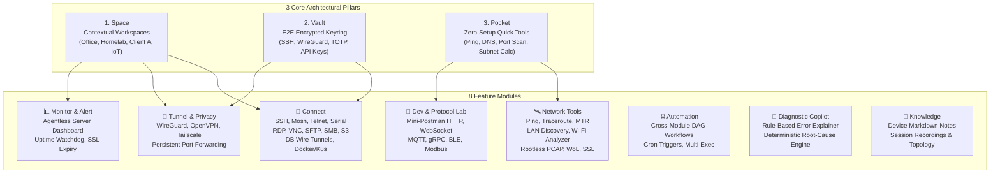

# Master Roadmap - ArnTCLI (v0.1 - v10.0)
Last Updated: 2026-10-19
Tagline: *"Your network, in your pocket."*
Archetype: Network Swiss Army Knife (Connect, Inspect, Troubleshoot, Manage)
Architecture Mode: 100% Offline-First, Zero Forced Cloud, Zero Local AI Weight

---

## 1. Executive Summary & Core Philosophy

ArnTCLI is a mobile infrastructure workstation and network Swiss Army knife built for Android. Rather than a fragmented collection of ad-supported utilities or subscription-gated terminal apps, ArnTCLI unifies remote access, low-level network diagnostics, development protocol labs, cryptographic key management, and agentless monitoring into a singular, tactile **Electric Slate** interface.

### The Anti-Bloat, Zero-Cloud Guarantee
Most modern network and terminal tools have alienated power users through three anti-patterns:
1. **Forced Cloud & Telemetry**: Termius and Fing force account creation, cloud telemetry, and remote credential storage, creating severe security and data-sovereignty liabilities.
2. **Subscription Fatigue**: Basic features like port forwarding, snippet sharing, and SFTP are locked behind \$10–\$15/month subscriptions.
3. **Heavy AI Hype & Resource Drain**: Forcing multi-gigabyte local LLM runtimes or cloud AI proxies on mobile drains battery, slows responsiveness, and risks sending sensitive network credentials off-device.

**ArnTCLI's Architecture Core:**
- **Zero Cloud Requirement**: Every protocol engine, cryptographic vault, and diagnostic probe operates 100% locally on-device.
- **Deterministic Heuristics Over AI Gimmicks**: Diagnostic conclusions ("Why is my network slow?", "Why did the TLS handshake fail?") use deterministic state-machine analyzers and rule-based network tree inspectors—giving instant, reliable, battery-friendly answers without any LLM server or on-device neural model.
- **Air-Gapped Multi-Device Sync**: Vault sync operates via animated QR codes (BC-UR / Luby Transform fountain codes) or encrypted local JSON files—zero cloud relay required.

---

## 2. The Three Architectural Pillars

### Pillar 1: Space (Contextual Workspace)
A Space represents an isolated operational boundary (e.g., *"Homelab"*, *"Client Corp"*, *"Office Work"*, *"Smart Home IoT"*).
- **Environment Isolation**: Unique hosts, devices, network tunnels, snippets, markdown notes, and dashboards per Space.
- **Context-Bound Networking**: Auto-connect specific WireGuard/OpenVPN profiles or SOCKS proxies upon opening a Space; auto-disconnect upon leaving.
- **Privacy Controls**: Supports isolated personal spaces or encrypted team-shared spaces with fine-grained access tokens.

### Pillar 2: Vault (End-to-End Encrypted Keyring)
A zero-knowledge encrypted credential repository serving every module in the application.
- **Unified Credential Storage**: SSH private keys (RSA 2048-4096, Ed25519), passwords, API tokens, X.509 certificates, `.ovpn` profiles, WireGuard keys, and TOTP 2FA seeds.
- **Single-Source Authentication**: Save a credential once; deploy it across SSH, SFTP, RDP, SMB, HTTP client, and database tunnels seamlessly.
- **Hardware & Biometric Security**: Unlocked via Android Keystore + BiometricPrompt (`CryptoObject`), hardware security keys (YubiKey over NFC/USB-OTG via FIDO2/PIV), and configurable auto-lock timers.
- **Zero-Cloud Air-Gapped Sync**: Synchronize vaults across devices using animated high-density QR codes (BC-UR format with Luby Transform fountain codes) or client-side encrypted JSON payloads.

### Pillar 3: Pocket (Instant Utility Tool Belt)
Zero-configuration diagnostic toolbox accessible instantly without creating a Space or configuring credentials.
- **Instant Actions**: Fast ICMP ping, full DNS lookup, port check, and CIDR subnet calculator.
- **System Integration**: Accessible directly from Android Quick Settings tiles, home screen widgets, and app shortcut long-press menus.

---

## 3. Developer Standards & Android Rootless Platform Engineering

Modern Android (Android 10 through Android 16 / targetSdk 36) imposes severe security and background restrictions. ArnTCLI uses verified, standards-compliant techniques to deliver desktop-grade functionality without requiring root access.

### 3.1 Network Discovery Without Root (Overcoming the Android 10+ ARP Block)
In Android 10+, `/proc/net/arp` was blocked (`EACCES`), and MAC addresses return `02:00:00:00:00:00`. ArnTCLI achieves >90% true MAC and hardware vendor identification through multi-protocol synthesis:
1. **NetBIOS Node Status (UDP 137)**: Probing port 137 on active LAN hosts returns Windows, Linux (Samba), and NAS computer names, domain memberships, and the adapter's physical MAC address directly in the payload header.
2. **mDNS & Bonjour Querying**: Probing `_raop._tcp.local` (Apple AirPlay) and `_spotify-connect._tcp.local` reveals raw hardware MAC addresses in the TXT records.
3. **UPnP / SSDP Discovery (UDP 1900)**: Probing UPnP root devices parses XML device descriptions where device UUIDs (Version 1) contain the host MAC address in the 48-bit node field.
4. **IPv6 Neighbor Discovery (SLAAC EUI-64)**: Reverse-computing the hardware MAC address from stateless autoconfigured IPv6 link-local addresses (`fe80::...`).
5. **Embedded IEEE OUI Radix Trie (~220 KB)**: An offline binary search trie mapping 45,000+ IEEE MAC prefixes to manufacturers, resolving vendors instantly with zero network lookups.

### 3.2 Wi-Fi Analyzer Without Throttling Lockout
Android throttles `WifiManager.startScan()` to 4 times per 2-minute window for foreground apps. ArnTCLI decouples the analyzer:
- **Continuous 1Hz Walk-Test Graphs**: Leverages unthrottled `WifiManager.getConnectionInfo()` / `NetworkCapabilities` polling to capture connected BSSID, RSSI, link speed, frequency, and channel utilization at 1 second intervals for smooth real-time walking graphs.
- **Neighbor Channel Rating**: Rates 2.4 GHz, 5 GHz, and 6 GHz (Wi-Fi 6E/7) channels based on cached scan passes + Reduced Neighbor Reporting (RNR) from beacon frames.

### 3.3 Rootless Packet Capture & WireGuard Mutual Exclusion
Android restricts the system to a single active `VpnService`:
- **Standalone Capture Mode**: Spawns a local userspace TUN loopback interface (`VpnService.Builder`). Packet headers are captured into an in-memory ring buffer, streamed to a `.pcap` file via Storage Access Framework (SAF), or streamed live to desktop Wireshark over local HTTP (`http://<device-ip>:8080/live.pcap`).
- **WireGuard + PCAP Coexistence**: When WireGuard is active, packet capture hooks directly into WireGuard's userspace ring buffer before encryption—enabling simultaneous packet inspection and VPN connectivity without crashing the Android network stack.

### 3.4 Background Port Forwarding & Android 14–16 Survival
To prevent Android OEMs and OS battery managers from killing persistent tunnels:
- **Process Isolation**: Spawns a dedicated `:tunnel_process` (~18–25 MB heap), isolating network sockets from UI configuration memory churn.
- **Foreground Service Type**: Uses `android:foregroundServiceType="specialUse"` with explicit ongoing notification and traffic meter. Strictly avoids `dataSync` (which Android 15 kills after a hard 6-hour limit).
- **Socket Pacing**: Configures TCP keepalives (`SO_KEEPALIVE`) and application-level SSH ping packets every 30 seconds, maintaining cellular and Wi-Fi NAT gateway mappings without waking up the high-power CPU.

### 3.5 Cryptographic Architecture & Hardware Security
- **Key Derivation**: Argon2id ($m=64\text{MB}, t=3, p=4$) via pure Kotlin/native libsodium bindings.
- **Symmetric Encryption**: Authenticated AES-256-GCM and ChaCha20-Poly1305.
- **Hardware Enclave**: Master keys sealed in hardware StrongBox / Android TEE with `setInvalidatedByBiometricEnrollment(true)`. Unlocks invoke `BiometricPrompt.CryptoObject`.
- **YubiKey Integration**: Uses YubiKit for Android supporting FIDO2 (WebAuthn `hmac-secret` PRF extension) and PIV (smartcard slot 9D ECDH/RSA) over both NFC and USB-OTG.

### 3.6 Dev Lab & Interactive Scripting Without Heavy Node.js
- **Mini-Postman Engine**: Built on OkHttp 4.12 + `okhttp-sse`.
- **Postman Script Compatibility**: Uses embedded QuickJS (`dokar3/quickjs-kt`, ~1.8 MB binary) to execute `pm.environment.set()`, pre-request scripts, and test assertions in <4ms with ~2 MB RAM footprint—eliminating heavy Node.js runtimes.
- **Dynamic Protobuf / gRPC**: Square `wire-schema` parses `.proto` definitions at runtime dynamically without compiling code on the phone.

---

## 4. Master Phased Roadmap (v0.1 to v10.0)

| Version Milestone | Strategic Focus | Deliverables & Scope | Technical Engine / Architecture |
| :--- | :--- | :--- | :--- |
| **v0.1.0** *(Baseline)* | **Foundation & Design System** | • Repository baseline, Gradle build pipeline, `VerifyAndroidRulesTask`. • Electric Slate dark design system & Elms Sans typography. • Initial Space model, Vault encryption skeleton, Import/Export contracts. • Pocket basic utilities (Ping, DNS lookup, Subnet calculator). | Kotlin Compose, Material 3, Android Keystore, VerifyAndroidRulesTask. |
| **v0.2.0** | **Tactile Terminal & Core Pocket Diagnostics** | • Production SSH v2 client with Ed25519 / RSA key auth. • Interactive terminal emulator buffer with ANSI 256-color & custom key bar (Esc, Ctrl, Alt, Tab, Arrows). • Pocket ICMP Ping with millisecond jitter graph. • Pocket Full DNS query tool (A, AAAA, CNAME, MX, TXT, NS, PTR, SOA, SRV, DoH/DoT). • CIDR Subnet Calculator with binary mask & usable host range view. | `sshj:0.40.0`, BouncyCastle, DnsJava + OkHttp DoH, custom Compose Canvas terminal buffer. |
| **v0.3.0** | **Network Reconnaissance & Wi-Fi Analyzer** | • LAN Discovery engine (NetBIOS, mDNS, UPnP, IPv6 EUI-64). • Offline 45,000-entry IEEE OUI vendor lookup trie. • Continuous MTR & visual Traceroute with AS-lookup. • Wi-Fi 2.4/5/6GHz channel analyzer with 1Hz live RSSI graph. • Wake-on-LAN magic packet dispatcher. • Android Quick Settings tiles & Home Screen diagnostic widgets. | Custom UDP probes, Java DatagramSocket, `WifiManager.getConnectionInfo`, Glance AppWidgets. |
| **v0.4.0** | **Secure SSH Engine & Persistent Tunnels** | • Background persistent SSH port forwarding (Local `-L`, Remote `-R`, Dynamic SOCKS5 `-D`). • Dedicated `:tunnel_process` with `specialUse` foreground service. • SSH Jump Host / Bastion tunneling chaining. • SSH Agent forwarding & X11 forwarding toggle. • Terminal session multiplexer (split-panes, tabs, multi-session dock). | `sshj`, isolated Android service process, `SO_KEEPALIVE` socket pacing, Netty SOCKS5 handler. |
| **v0.5.0** | **WireGuard Engine, SFTP & Vault Air-Gapped Sync** | • Native WireGuard client engine (userspace Go/Rust backend). • Dual-pane SFTP file manager with built-in text/code editor and chmod inspector. • Vault Air-Gapped Sync: Animated high-density QR codes (BC-UR / Luby Transform). • Hardware Security Key integration: YubiKey NFC/OTG FIDO2 `hmac-secret` and PIV. | `wireguard-android`, BouncyCastle SFTP, YubiKit, ZXing + BC-UR fountain codec. |
| **v0.6.0** | **Remote Desktop & Cloud Storage** | • High-performance RDP and VNC viewer with virtual trackpad and clipboard sync. • Cloud & NAS Storage integrations: SMB 2/3, WebDAV, NFS v4, AWS S3 / MinIO. • Background file transfer manager with paused/resumed stream resilience. • In-situ media viewer (image preview, hex editor for binary files). | FreeRDP JNI / pure Kotlin VNC, `smbj:0.13.0`, OkHttp AWS SigV4, SAF integration. |
| **v0.7.0** | **Dev Lab: Mini-Postman, WebSocket & IoT** | • Mini-Postman HTTP/GraphQL client with environments and collections. • Embedded QuickJS engine for Postman `pm.*` test script execution. • Real-time WebSocket and MQTT client (topic subscribe, message publish). • Dynamic gRPC client with runtime `.proto` schema reflection. • BLE peripheral scanner with GATT service tree explorer & NFC tag inspector. | OkHttp 4.12, `dokar3/quickjs-kt`, HiveMQ MQTT client, Square `wire-schema`, Nordic `ble-ktx`. |
| **v0.8.0** | **Agentless Server Telemetry & Watchdog** | • Agentless server dashboard: CPU, RAM, Disk, Load Average, systemd services via raw SSH `/proc` polling. • Background Uptime Watchdog service (HTTP, TCP, Ping) with instant failure alerts. • SSL/TLS certificate expiry watchdog (30d, 14d, 3d push notifications). • Space Device Topology visual node graph with live health badges. | SSH exec commands, WorkManager periodic workers, Compose Canvas node-graph layout. |
| **v0.9.0** | **Automation Workflows & Multi-Exec** | • Cross-Module DAG Workflow builder (*Connect WireGuard → SSH Run → HTTP Verify*). • Event triggers: Cron schedule, Wi-Fi SSID association, server-down webhooks. • Parallel Multi-Exec: Broadcast commands across multiple servers with diff output. • Terminal session recording in asciinema format. | Kotlin Coroutines DAG executor, Android `AlarmManager`, asciinema v2 recorder. |
| **v1.0.0** | **Production Release: PCAP, DB Tunnels & Copilot** | • Rootless Packet Capture engine (`VpnService`) with `.pcap` export & Wireshark streaming. • Database terminal clients: PostgreSQL, MySQL, Redis (RESP3) via SSH tunnel. • Docker & Kubernetes management (stream logs, inspect pods, restart containers, exec). • Privacy-First Diagnostic Copilot: Deterministic network triage heuristics & rule-based error explainer. | Userspace TUN loopback, pure Kotlin wire parsers, Docker REST API over SSH stream, zero-cloud triage engine. |
| **v2.0.0 - v3.0.0** | **Encrypted Team Spaces & Vault Sharing** | • Encrypted Team Spaces with role-based access control (RBAC). • Team Vault sharing using asymmetric public-key cryptography (Curve25519). • Immutable local audit logging for enterprise security compliance. • SSO authentication integration (OIDC, SAML, GitHub Enterprise). | libsodium asymmetric encryption, local encrypted SQLite audit logs, AppAuth OIDC. |
| **v4.0.0 - v5.0.0** | **Industrial IoT & Edge Hardware** | • Serial USB-OTG console terminal (FTDI, CP2102, CH340, PL2303) and Bluetooth RFCOMM. • Industrial protocol diagnostic tools: Modbus TCP/RTU and SNMP v2c/v3. • Router and switch firmware flashing / TFTP / Syslog server daemon. | `usb-serial-for-android`, SNMP4J with MIB-2 tree, pure Kotlin Modbus engine. |
| **v6.0.0 - v7.0.0** | **Distributed Mesh & Desktop Workstation Companion** | • Zero-config peer-to-peer mesh coordination (Tailscale / Nebula / WireGuard mesh). • Headless micro-agent daemon for automated homelab telemetry. • Cross-platform desktop companion (ArnTCLI Workstation for Windows, Linux, macOS) syncing peer-to-peer. | Tailscale userspace Go engine, Compose Multiplatform desktop companion, P2P sync. |
| **v8.0.0 - v10.0.0** | **Autonomous Infrastructure & Extensible Plugin SDK** | • Extensible Plugin SDK (Lua / Kotlin script runtime) for custom protocols and custom decoders. • Autonomous self-healing runbooks (detect degradation → trigger verified remediation sequence). • Deep network topological graph intelligence with automated vulnerability and port-exposure audits. | Embedded Lua / QuickJS Plugin host, automated topological correlation engine, offline CVE checker. |

---

## 5. Competitive Matrix & User Psychology

### 5.1 Competitive Comparison
| Feature Dimension | ArnTCLI | Termius | Fing / WiFiman | Termux |
| :--- | :--- | :--- | :--- | :--- |
| **Pricing Model** | 100% Free / Open Core | \$10–\$15 / month subscription | Ad-supported / Hardware upsell | Free / Open Source |
| **Cloud Dependency** | **Zero (100% Offline-First)** | Mandatory cloud account & sync | Cloud account required for history | Zero (Local only) |
| **Data Privacy** | All credentials locked on-device | Keys synced to Termius servers | Device scans uploaded to Fing cloud | Local on-device storage |
| **UI Experience** | Arinara Electric Slate dark system | Polished commercial GUI | Consumer-oriented GUI | Raw Linux CLI only (No GUI widgets) |
| **Network Diagnostics** | Deep (LAN, Wi-Fi 6E, PCAP, MTR) | Basic (SSH only) | Specialized (LAN/Wi-Fi only) | CLI packages (nmap, iproute2) |
| **Vault & Hardware Keys** | YubiKey NFC/OTG, StrongBox, QR | Proprietary cloud vault | None | OpenSSL / CLI gpg-agent |
| **Dev Lab & IoT** | Postman mini, MQTT, BLE, Modbus | None | None | CLI curl, mosquitto-clients |
| **Battery Impact** | Isolated `:tunnel_process` pacing | Moderate background drain | Low background activity | High background CPU if unmanaged |

### 5.2 Target Personas & Retention Drivers
1. **The DevOps & Linux Sysadmin**:
   - *Pain Point*: Being on-call without a laptop; unable to securely SSH into a bastion host through a jump server, verify Docker containers, or forward a remote port without paying \$120/yr to Termius.
   - *Retention Driver*: Rock-solid persistent SSH port forwarding, jump host chaining, and agentless server health dashboards.
2. **The Homelabber & Self-Hoster**:
   - *Pain Point*: Juggling 4 different apps (WireGuard, PingTools, Termius, Nextcloud/SMB) to manage home servers while on mobile.
   - *Retention Driver*: Contextual Homelab **Space** that auto-tunnels WireGuard, exposes SFTP/SMB storage, and displays server CPU/RAM metrics in one screen.
3. **The Network Field Engineer**:
   - *Pain Point*: Carrying heavy diagnostic equipment or dealing with Fing's aggressive upsells and ad banners during client network audits.
   - *Retention Driver*: **Pocket** tools (1-tap ICMP jitter, unthrottled Wi-Fi walking RSSI graph, offline IEEE OUI vendor discovery, and rootless `.pcap` export).
4. **The IoT & Hardware Hacker**:
   - *Pain Point*: Requiring separate tools to inspect BLE beacons, query MQTT brokers, and plug into USB-OTG serial consoles on embedded boards.
   - *Retention Driver*: Integrated Dev Lab with BLE GATT explorer, MQTT subscriber, and USB serial terminal in a single dark UI.

---

## 6. Implementation Architecture & Codebase Guidelines

1. **Strict Modularization**:
   Core capabilities reside in isolated modules to prevent monolithic bloat:
   - `:core:designsystem` (Electric Slate tokens, presets, typography, spring physics)
   - `:core:vault` (Argon2id, Android Keystore, AES-256-GCM, YubiKit)
   - `:core:terminal` (SSHJ, ANSI VT100/220 buffer, custom input bar)
   - `:feature:pocket` (Instant ping, DNS, subnet calculator)
   - `:feature:nettools` (LAN discovery, Wi-Fi analyzer, traceroute, WoL)
   - `:feature:tunnel` (WireGuard, isolated `:tunnel_process`, SOCKS5)
   - `:feature:devlab` (Mini-Postman, QuickJS, MQTT, BLE)
   - `:feature:monitor` (Agentless SSH `/proc` polling, Uptime watchdog)
2. **Offline Data Storage**:
   - Local encrypted SQLite via Room with SQLCipher / raw encrypted files.
   - Zero remote crashlytics or third-party tracking SDKs.
3. **Rule Enforcement**:
   - Every build and commit must pass `./gradlew verifyAndroidRules` (AR-001 through AR-016).
   - All components adhere strictly to `#0D1117` background, `#161C26` card surface, `#7A5AF8` violet accent, and Elms Sans typography.
